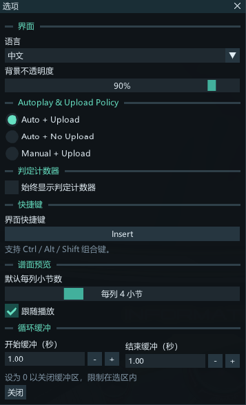

# Training Master

**English** | [简体中文](README.zh.md)

Training Master is a training mod for SDVX that provides a rich set of practice features.

> [!WARNING]
> Do not use it for leaderboard cheating.

> [!NOTE]
> Supports EXCEED GEAR FINAL (2025120900), NABLA and above.

## Download

Go to the Actions page and download the latest build.

## Usage

Place `trainingmaster.dll` and `trainingmaster.ini` in the contents root or the modules folder, then use spice2x to inject the hook.

After launching the game, press `Insert` to open the interface, or visit http://127.0.0.1:27182/

## Features

> [!NOTE]
> When these features are enabled, scores will be uploaded and recorded by default. To prevent upload, modify the "Autoplay & Upload Policy" option, or set "Autoplay & Upload Policy" (three levels) in the WebUI.

| Feature | Description |
| --- | --- |
| Playback controls | Seek, pause, resume, or play in reverse |
| Playback rate | Adjust speed from 0.25x to 2.00x, with preset buttons |
| Looping | Mark IN and OUT points to loop continuously or loop once |
| Loop buffer | Set the time added before and after the selected loop |
| Chart view | View notes and knob trajectories, and edit loop points |
| AutoPlay | Enable native auto-play: All, Buttons only, or Knobs only |
| Lane speed | Lock the lane speed |
| Camera | Prevent camera movement |
| Hide song visuals (Experimental) | Hide extra sprite animations, screen effects, and Live2D during practice; some effects cannot be removed |
| Gauge | Override the gauge type and initial value |

## Third-Party Components

- [ImGui](https://github.com/ocornut/imgui)
- [MinHook](https://github.com/tsudakageyu/minhook)

## AI

All code was written and reverse-engineered by AI  
UI design by human
